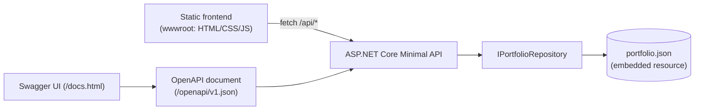

# kennys-portfolio

> A portfolio that is also a backend project: an **ASP.NET Core (.NET 9) API** serves my profile, case studies, experience and skills, and a small **static frontend** renders itself by calling that API.

The site you see is the proof of work: filtering projects in the UI issues a real `GET /api/projects?technology=…` call, and the same API is documented with OpenAPI and Swagger UI.

## Architecture



## Endpoints

| Method | Route | Description |
|---|---|---|
| GET | `/api/portfolio` | Everything in a single payload |
| GET | `/api/profile` | Name, headline, summary, links |
| GET | `/api/experience?technology=` | Work history, filterable by technology |
| GET | `/api/experience/{id}` | One entry (404 as RFC 9457 problem details) |
| GET | `/api/projects?technology=` | Case studies, filterable by technology |
| GET | `/api/projects/{id}` | One case study |
| GET | `/api/skills?category=` | Skills by area |
| GET | `/api/education` · `/api/certifications` · `/api/courses` · `/api/languages` | Learning and background |
| GET | `/health` | Health check |
| GET | `/openapi/v1.json` · `/docs.html` | OpenAPI document and Swagger UI |

Examples:

```bash
curl "http://localhost:8080/api/projects?technology=azure"
curl "http://localhost:8080/api/experience?technology=hangfire"
curl "http://localhost:8080/api/skills?category=cloud"
```

## Run it

**With Docker**

```bash
docker compose up --build
# http://localhost:8080
```

**With the .NET 9 SDK**

```bash
dotnet run --project src/Portfolio.Api
# the URL is printed in the console
```

**Tests**

```bash
dotnet test
```

## Project layout

```
.
├── src/Portfolio.Api
│   ├── Program.cs                  # composition root: DI, rate limiting, problem details, OpenAPI
│   ├── Endpoints/                  # minimal API endpoints grouped under /api
│   ├── Data/                       # IPortfolioRepository + JSON implementation, portfolio.json
│   ├── Models/                     # immutable records
│   └── wwwroot/                    # static frontend (no framework, no build step)
├── tests/Portfolio.Api.Tests       # xUnit: integration (WebApplicationFactory) + unit tests
├── Dockerfile                      # multi-stage build, runs as non-root
├── docker-compose.yml
└── .github/workflows/ci.yml        # restore, build, test with coverage, docker build
```

## Design decisions

- **Minimal APIs + a small repository interface.** Endpoints depend on `IPortfolioRepository`, not on JSON. Replacing the JSON file with MongoDB or EF Core means adding one class and changing one line in `Program.cs`.
- **Data embedded in the assembly.** No database to run and no file paths to break in containers. The trade-off: changing content means rebuilding. That is the right call for static portfolio data.
- **Same-origin frontend.** The API serves the UI from `wwwroot`, so there is no CORS surface to configure or get wrong.
- **Rate limiting on `/api/*`.** A fixed-window limiter (default 120 requests/minute, configurable via `RateLimit__PermitLimit`) returns `429` instead of letting a public endpoint be hammered.
- **Consistent errors.** Unknown ids return `application/problem+json`, and unhandled exceptions go through the same problem-details pipeline.
- **Safe rendering.** The frontend builds DOM nodes with `textContent`; it never injects data as HTML.
- **Container hygiene.** Multi-stage Dockerfile, restore layer cached separately, non-root runtime user.
- **Tests at two levels.** Integration tests exercise the real HTTP pipeline (routing, filtering, 404s, static files, OpenAPI); unit tests protect the data contract (unique ids, required sections).

## Make it yours

1. Edit `src/Portfolio.Api/Data/portfolio.json` (profile, experience, projects, skills, …).
2. Replace the `TU-USUARIO` placeholders (LinkedIn/GitHub links) in that file and in this README.
3. Run the tests: they check that ids are unique and every section is present.

## Live site (GitHub Pages + hosted API)

The portfolio is published in two pieces:

- **Frontend** on GitHub Pages (static files). The workflow `.github/workflows/pages.yml` publishes `index.html`, `styles.css`, `app.js` and `portfolio.json` on every push to `main`, and writes `config.js` with the URL of the hosted API. One-time setup: **Settings → Pages → Build and deployment → Source: GitHub Actions**.
- **API** in a Docker container on a free plan (Render). Because the page and the API live on different origins, the API allows `https://kalfaroperez.github.io` through CORS (`Cors__AllowedOrigins__0` overrides it).

The page calls the API first. Free plans sleep when idle, so if the API does not answer within 8 seconds the page shows a static copy of the same data from `portfolio.json` and pings `/health` to wake the service up. Locally (`dotnet run` / Docker) `config.js` is empty and everything is same-origin.

To change the API address, edit `API_BASE_URL` in `pages.yml`.

## Roadmap

- [ ] Swap the JSON repository for MongoDB behind the same interface
- [ ] Response caching / ETags for the read-only endpoints
- [ ] OpenTelemetry traces and metrics
- [ ] Deploy workflow (build image → push → release)
